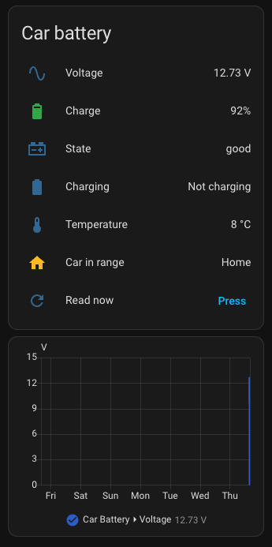
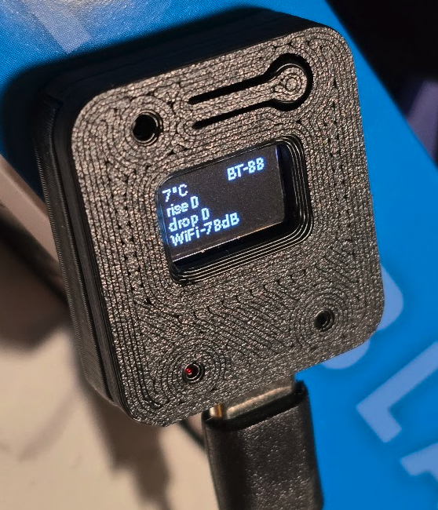
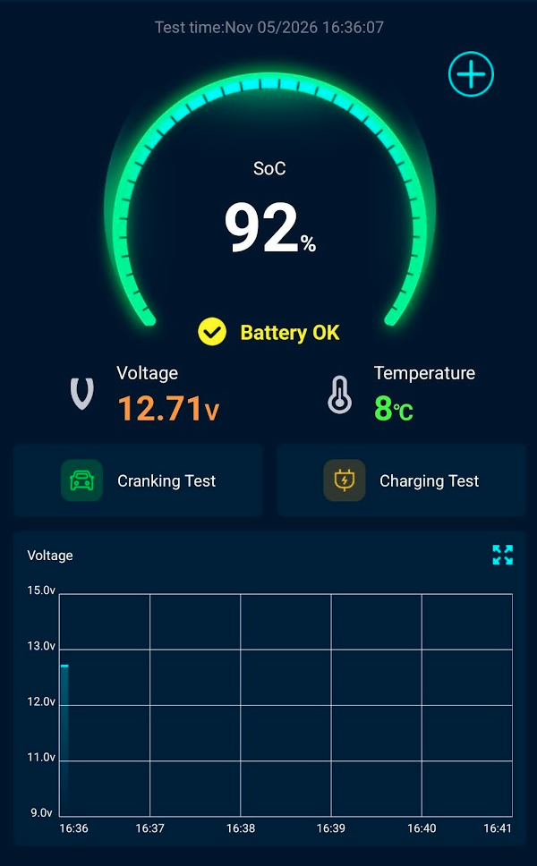

# Car Battery Guard → Home Assistant (ESP32-C3 + 0.42" OLED)

Reads an **intAct Battery Guard** (or any other BM6-family Bluetooth
battery monitor) on a car battery and puts voltage, state of charge,
temperature and charging state into Home Assistant. It uses a €5 ESP32-C3
board running ESPHome. The board's built-in OLED shows the latest voltage,
so you can check the car battery at a glance in the garage.

```
 Battery Guard (on car battery) --BLE, AES-128--> ESP32-C3 + OLED --WiFi / ESPHome API--> Home Assistant
```

- No MQTT broker and no cloud: Home Assistant discovers the board through
  the ESPHome integration.
- Battery-friendly: it connects for about 3 seconds every 15 minutes and
  disconnects in between, so the phone app still works between readings.
- Low-battery notification automation and a dashboard card are included.

## What it looks like

| Home Assistant | The board | intAct phone app |
|:---:|:---:|:---:|
|  |  |  |

The same battery seen three ways, on the same afternoon:

- **Home Assistant** (left) gets a reading every 15 minutes: voltage,
  charge, a resting-voltage rating (`good` / `ok` / `low` / `critical` /
  `charging`), the charging flag and temperature. `Car in range` turns
  *Home* when the last cycle reached the Battery Guard, and `Read now`
  takes a reading on demand. The card is
  [`homeassistant/dashboard_card.yaml`](homeassistant/dashboard_card.yaml).
  The graph builds up a voltage history over the week. It's one line here
  because the setup had just been installed.
- **The board** (middle), here in a 3D-printed case, normally shows SOC,
  the voltage in large digits, an SOC bar and how many minutes old the
  reading is. A long press on the BOOT button brings up the details screen
  in the photo: temperature, Bluetooth signal to the Battery Guard
  (`BT-88` dBm, workable through the car body and a garage wall), the
  Battery Guard's voltage rise/drop event counters, and WiFi signal. A
  short press takes a reading now.
- **The intAct app** (right) keeps working. The board holds the Bluetooth
  link for only about 3 seconds per cycle, so the phone can connect in
  between. Its 92 %, about 12.7 V and 8 °C match what Home Assistant
  shows. The small voltage difference comes from readings taken a few
  minutes apart.

The BLE protocol handling is adapted from
[Waldmensch1/BatteryGuard](https://github.com/Waldmensch1/BatteryGuard)
(MIT, PlatformIO + NimBLE + MQTT). This project ports it to ESPHome.

## Hardware

| Part | Notes |
|---|---|
| [intAct Battery Guard](https://www.amazon.de/dp/B00ZETXNAQ) | Clamps onto the 12 V battery. The MAC is the 12-character serial printed on it. Other BM6 clones (ANCEL BM200, Sealey BT2020, Quicklynks BM6) use the same protocol and should work. |
| [ESP32-C3 dev board with 0.42" OLED](https://www.amazon.de/dp/B0FWK7N67Y) | 72x40 SSD1306 on I2C (SDA GPIO5, SCL GPIO6). Any ESP32 works if you change the `esp32:` / `i2c:` / `display:` blocks, or remove the display. |
| USB-C power supply | Within Bluetooth range of the car: garage wall, window sill |

No wiring needed. See [docs/hardware.md](docs/hardware.md) for placement,
the display screens and the button.

**Not supported:** BM2-family devices (Ancel BM300 Pro and similar). They
use a different AES key.

## Quick start

1. **Copy the secrets template** and fill it in:
   ```sh
   cp esphome/secrets.yaml.example esphome/secrets.yaml
   ```
   - `bm6_mac`: your Battery Guard's serial, with colons
     (`A1B2C3D4E5F6` → `A1:B2:C3:D4:E5:F6`)
   - WiFi credentials, an API encryption key, and an OTA password
2. **Set your battery type** in `esphome/battery-guard.yaml` →
   `substitutions` → `battery_type`: `1` lead acid (default), `2` AGM,
   `5` lithium.
3. **Build and flash.** Use the ESPHome add-on in Home Assistant, or Docker
   plus a browser if you don't want to install anything locally. Both are
   covered in [docs/flashing.md](docs/flashing.md).
4. **Close the intAct phone app** for the first test. The Battery Guard
   accepts only one connection at a time.
5. **Add it to Home Assistant:** Settings → Devices & services → the
   discovered **Car Battery** device. It asks for the API key from step 1.
6. Optional: install the
   [low-battery alert and dashboard card](docs/home-assistant.md#automations-and-dashboard).

## How it works

1. Every 15 minutes (also at boot, from the `Read Now` button in HA, or a
   short press on the board's BOOT button) the board connects to the
   Battery Guard.
2. It sends the encrypted 6-write handshake to characteristic `FFF3`. The
   Battery Guard then notifies `FFF4` once a second.
3. `esphome/bm6.h` decrypts each frame (AES-128-CBC, zero IV, the static
   BM6 key) and parses voltage, SOC, temperature, status and the event
   counters.
4. As soon as one valid reading is in, the board disconnects again.
5. Readings go to Home Assistant right away. If two cycles in a row get
   nothing (car away), the sensors turn `unknown` instead of showing a
   stale voltage.

Protocol details: [docs/protocol.md](docs/protocol.md).

## Alternative: no extra hardware

If you already run ESPHome Bluetooth proxies and one of them reaches the
car, the [rafciq/bm6](https://github.com/rafciq/bm6) HACS integration can
read the Battery Guard through them. You get no display, and forum
reliability reports are mixed. Use either that or this board, never both:
they would compete for the single connection.
[docs/home-assistant.md](docs/home-assistant.md#alternative-no-extra-hardware-via-your-bluetooth-proxies)
has the setup steps.

## Repo layout

| Path | What |
|---|---|
| `esphome/battery-guard.yaml` | ESPHome device config: BLE client, poll cycle, sensors, display, button |
| `esphome/bm6.h` | AES and frame parsing for the BM6 protocol |
| `esphome/secrets.yaml.example` | Secrets template. Copy to `secrets.yaml`, which is gitignored. |
| `docs/hardware.md` | Parts, placement, display screens, BOOT button, battery drain |
| `docs/flashing.md` | Building and flashing, first-run checks, troubleshooting |
| `docs/home-assistant.md` | Entities, automation, dashboard, Bluetooth-proxy alternative |
| `docs/protocol.md` | BLE protocol reference |
| `docs/images/` | Screenshots used in this README |
| `homeassistant/` | Low-battery automation and dashboard card, ready to paste |

## Status

In daily use since November 2026 with an intAct Battery Guard on a
lead-acid car battery (ESPHome 2026.10.2). Voltage, SOC, temperature and
the poll cycle are verified. Charging detection (status byte `02` with the
engine running) follows upstream's findings but hasn't been observed on
this setup yet.

Reports from other BM6 clones are welcome. See
[CONTRIBUTING.md](CONTRIBUTING.md).

## License

MIT. See [LICENSE](LICENSE). The protocol work is credited to
[Waldmensch1/BatteryGuard](https://github.com/Waldmensch1/BatteryGuard)
(MIT) and
[tarball.ca](https://www.tarball.ca/posts/reverse-engineering-the-bm6-ble-battery-monitor/).
